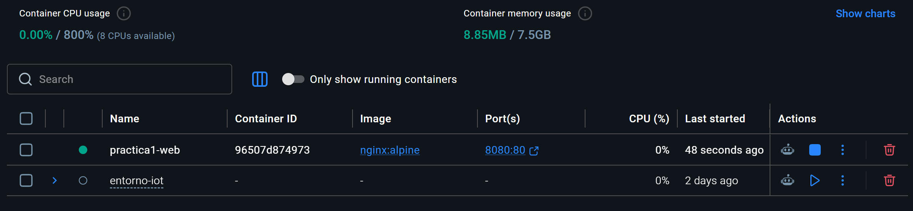
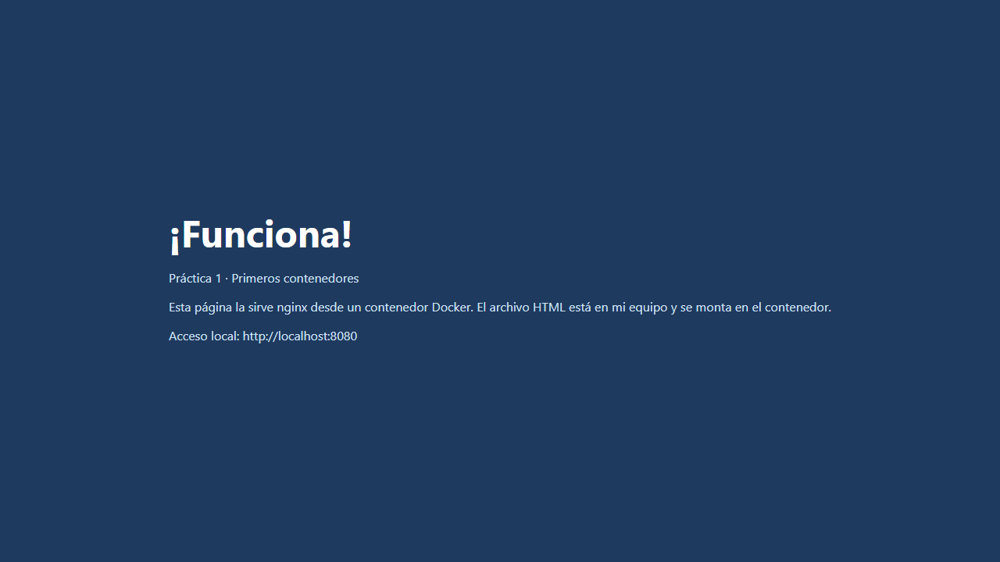

# Práctica 1: Primeros contenedores

Partí de la página que nos dieron en clase.

1. Primero comprobé que Docker Desktop funcionaba con `docker run --rm hello-world`. Me salió el mensaje de confirmación.
2. Después arranqué un contenedor llamado `practica1-web` con Nginx. Le indiqué que enseñara la página de la carpeta `html` y usé el puerto 8080 de mi equipo.
3. Entré en `http://localhost:8080` y vi la página con el mensaje «¡Funciona!».
4. Cambié el título y el texto de `html/index.html`, actualicé el navegador y vi el cambio sin tener que crear otra vez el contenedor.

Guardé una captura de la página (`evidencia-web.png`) y otra del contenedor en Docker Desktop (`evidencia-docker.png`).

## Lo que fui viendo

Primero comprobé que el contenedor `practica1-web` estaba en marcha en Docker Desktop.

Después abrí la página en el navegador y vi el resultado del cambio que hice en el HTML.

