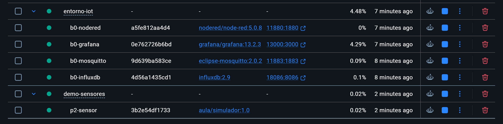

# Práctica 2: Tu primera imagen

Partí del programa Python y del Dockerfile que nos dio el profesor. No tuve que cambiar esos dos archivos.

1. En esta carpeta ejecuté `docker build -t aula/simulador:1.0 .` para crear mi imagen.
2. Añadí `mosquitto.conf` para poder probarla por separado. También creé la red `p2-net` y arranqué Mosquitto con el nombre `p2-mqtt`.
3. Arranqué el contenedor `p2-sensor` con mi imagen. Lo conecté a Mosquitto y le indiqué que enviara una temperatura cada dos segundos con el nombre `practica2`.
4. Miré los registros del sensor y vi varias temperaturas. Luego me puse a escuchar su canal de mensajes en Mosquitto y recibí una lectura. Guardé el resultado en `evidencia-mqtt.txt`.

También guardé una captura del contenedor (`evidencia-contenedor-sensor.png`) y otra de sus registros (`evidencia-logs-temperatura.png`).

## Lo que fui viendo

Primero comprobé en Docker Desktop que el contenedor del sensor estaba funcionando.

Luego abrí sus registros y vi las temperaturas que iba enviando.

