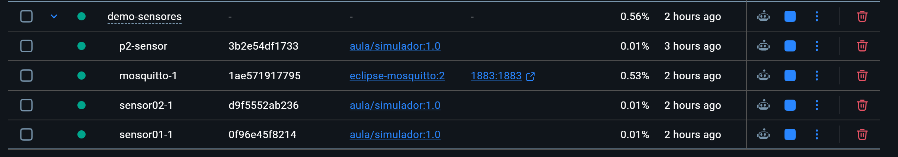
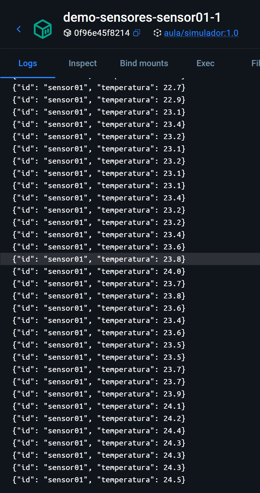
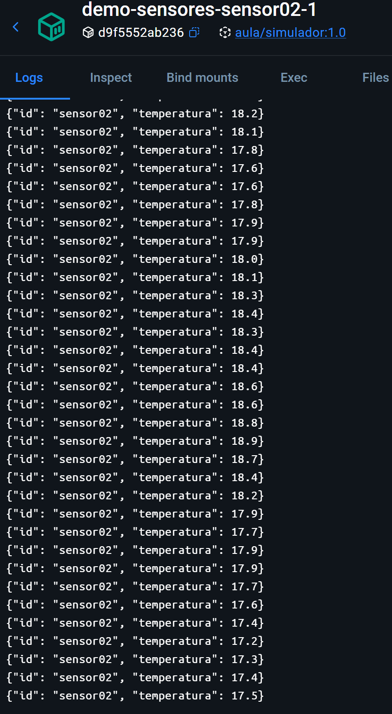

# Práctica 3: Un entorno con Compose

Aquí usé los archivos de Compose y el simulador que nos dieron. No cambié esos archivos.

1. Entré en `03-compose` y comprobé que la configuración estaba bien con `docker compose config --quiet`.
2. Ejecuté `docker compose up -d --build`. Así arranqué Mosquitto y los dos sensores, `sensor01` y `sensor02`.
3. Con `docker compose ps` comprobé que Mosquitto estaba funcionando y que los dos sensores seguían encendidos.
4. Me puse a escuchar el canal de mensajes de cada sensor. Recibí una temperatura de cada uno y guardé la prueba en `evidencia-compose.txt`.
5. Al terminar la primera prueba paré los contenedores con `docker compose down`. Más adelante los volví a arrancar para revisarlos otra vez.

Guardé tres capturas: los contenedores en Docker Desktop y los registros de cada sensor. Están en esta carpeta. Compose también usa `02-simulador` para construir la imagen de los sensores.

## Lo que fui viendo

Primero comprobé que Mosquitto, `sensor01` y `sensor02` estaban en marcha a la vez.

Después miré los registros de `sensor01` y vi las temperaturas que iba enviando.

Hice lo mismo con `sensor02` para comprobar que también enviaba sus propias lecturas.

