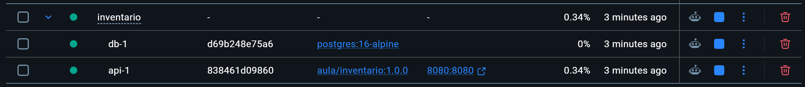
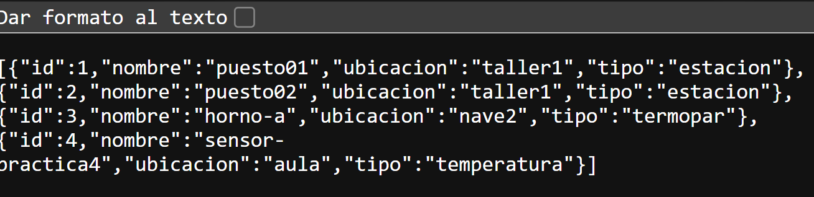

# Práctica 4: Conteneriza tu microservicio

El código Java, el Dockerfile, Compose y el `.env` ya estaban en la carpeta. Yo no cambié esos archivos; puse en marcha la práctica y probé que funcionara.

1. Comprobé la configuración y arranqué la API y PostgreSQL con `docker compose up -d --build`.
2. Esperé a que los dos contenedores aparecieran como correctos en `docker compose ps`.
3. Abrí `http://localhost:8080/actuator/health` y recibí `UP`, que indica que la API respondía.
4. Abrí `http://localhost:8080/api/dispositivos` y vi tres dispositivos. Después envié una petición para añadir `sensor-practica4`; al consultar la lista otra vez, aparecieron cuatro.
5. Guardé el resultado en `evidencia-api.txt` y paré los contenedores con `docker compose down`, sin borrar los datos guardados.

Más adelante volví a arrancar la práctica y comprobé que la API seguía respondiendo y que los cuatro dispositivos continuaban en la lista. Guardé dos capturas: la lista de dispositivos y los contenedores en Docker Desktop.

## Lo que fui viendo

Comprobé en Docker Desktop que la API y PostgreSQL estaban en marcha.

Después abrí la lista de dispositivos y vi el resultado de la prueba que hice con la API.

