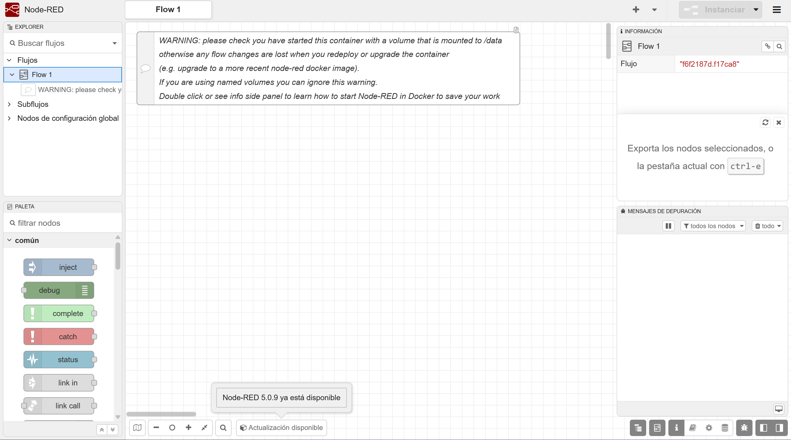
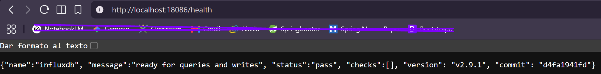
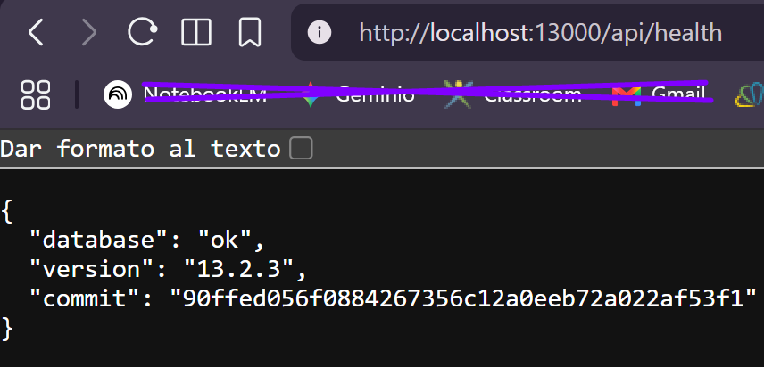

# Práctica 5: Despliega el entorno del curso

Para esta práctica usé los archivos de Compose, los scripts y la configuración que nos dio el profesor. Guardé el README original en `DOCUMENTACION_ORIGINAL_PROFESOR.md`.

1. Comprobé que el `.env` de mi equipo ya tenía sus valores puestos y que `docker compose config --quiet` aceptaba la configuración.
2. Intenté ejecutar `desplegar.ps1`, pero PowerShell lo bloqueó porque el script no estaba firmado. Lo volví a ejecutar con `pwsh -NoProfile -ExecutionPolicy Bypass -File .\desplegar.ps1` y esta vez funcionó.
3. Esperé hasta ver que Mosquitto, Node-RED, InfluxDB y Grafana estaban funcionando.
4. Abrí Node-RED, InfluxDB y Grafana para comprobar que respondían. También envié un mensaje de prueba a Mosquitto y comprobé que llegaba. En Grafana vi que aparecía la fuente de datos de InfluxDB llamada `aula`.
5. Guardé estas comprobaciones en `evidencia-entorno.txt`.

Hice cuatro capturas: los contenedores en Docker Desktop, Node-RED abierto y las respuestas de salud de InfluxDB y Grafana. Las guardé en esta carpeta. No creé flujos, medidas ni paneles, porque en esta práctica comprobé el despliegue del entorno.

## Lo que fui viendo

Primero comprobé en Docker Desktop que Mosquitto, Node-RED, InfluxDB y Grafana estaban en marcha.

Después abrí Node-RED y vi que el editor cargaba correctamente.

También abrí la dirección de salud de InfluxDB y recibí el estado `pass`.

Por último, comprobé la dirección de salud de Grafana y vi que su base de datos respondía `ok`.

