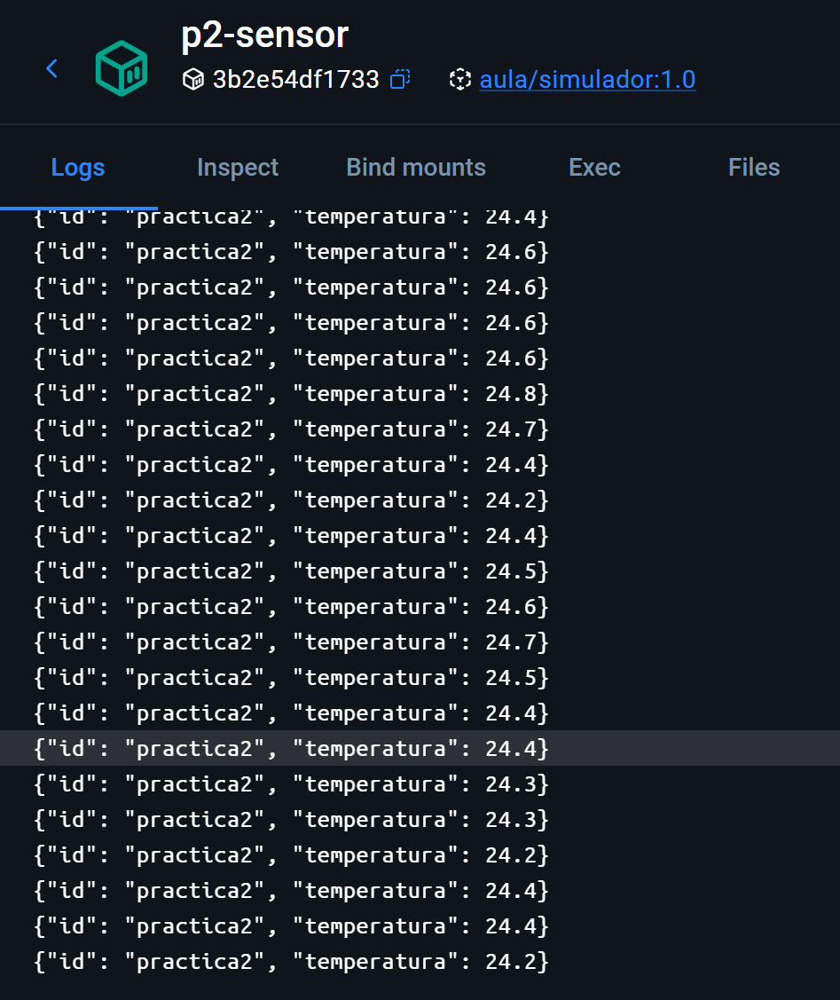
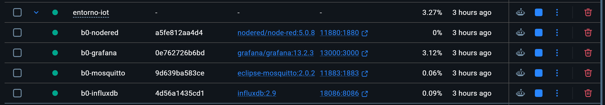

# Mis prácticas de Docker

Aquí he juntado las cinco prácticas. Partí de los archivos que nos dio el profesor y fui probando cada una en mi equipo con Docker Desktop. En el README de cada carpeta cuento los pasos que seguí y lo que comprobé al final.

- [Práctica 1: Primeros contenedores](01-web/README.md)
- [Práctica 2: Tu primera imagen](02-simulador/README.md)
- [Práctica 3: Un entorno con Compose](03-compose/README.md)
- [Práctica 4: Conteneriza tu microservicio](04-springboot/README.md)
- [Práctica 5: Despliega el entorno del curso](05-entorno-iot/README.md)

Dejé las capturas dentro de la carpeta de cada práctica. Los archivos `.env` con mis claves se quedan solo en mi equipo y no se suben a GitHub.

El README que venía con la práctica 5 lo guardé sin cambiarlo en [DOCUMENTACION_ORIGINAL_PROFESOR.md](05-entorno-iot/DOCUMENTACION_ORIGINAL_PROFESOR.md).

## Así fui comprobando las prácticas

### 1. Primeros contenedores

Arranqué la web con Nginx y comprobé en el navegador que se veían los cambios que hice en la página.

### 2. Mi primera imagen

Construí la imagen del sensor y miré sus registros para comprobar que iba enviando temperaturas.

### 3. Los sensores con Compose

Arranqué Mosquitto y los dos sensores juntos y comprobé que los tres contenedores estaban en marcha.

### 4. El microservicio

Abrí la API en el navegador y comprobé que mostraba la lista de dispositivos.

### 5. El entorno del curso

Al final arranqué los cuatro servicios del entorno y comprobé que todos aparecían funcionando en Docker Desktop.

